<a href="#quick-start">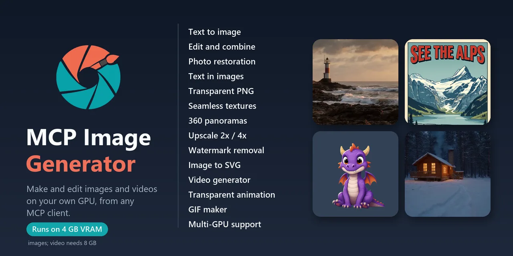</a>

## Make your own `<insert-image-here>`

A self-hosted [Model Context Protocol](https://modelcontextprotocol.io) server that makes and edits images and
videos on your own computer: images with **Qwen-Image-2.1**, videos with **Kandinsky 6** (optional). Ask for an image
or a video in VS Code, Cursor, Claude Code, LM Studio or any other MCP client on your network, and it appears in the
chat.

> *Your GPU, your images. No cloud, no account, no content filter.*

* [Text to image](#make-your-own-text-to-image)
* [Edit](#make-your-own-edit)
* [Restoration](#make-your-own-restoration)
* [Text in images](#make-your-own-text-in-images)
* [Transparent PNG](#make-your-own-transparent-png)
* [Seamless texture](#make-your-own-seamless-texture)
* [360 panorama](#make-your-own-360-panorama)
* [Upscale](#make-your-own-upscale)
* [Watermark removal](#make-your-own-watermark-removal)
* [SVG](#make-your-own-svg)
* [Video](#make-your-own-video), [Animation](#make-your-own-animation) and [GIF](#make-your-own-gif) (optional
  [video extension](#video-extension))

- **Easy to run.** Install Docker, then run `start.cmd` (Windows) or `./start.sh` (Linux). Press Enter at each
  question. The script finds your GPU, picks the model, downloads it and starts the server.
- **Low VRAM.** It runs on a 4 GB NVIDIA GPU. What does not fit on the GPU stays in RAM. You can also split the model
  over several GPUs and the CPU. See [GPU memory](#gpu-memory).
- **Fast.** Turbo makes a 1344x768 photo in 5 s on an RTX 5090 and in 12 s on an RTX 3080 Ti.
- **Quality.** The Non-Turbo model writes small text well and follows long prompts closely. See
  [Turbo or Non-Turbo](#turbo-or-non-turbo).
- **Mac.** For now, Docker on a Mac uses only the CPU. A native version for the Apple GPU is in development: see
  [Mac](docs/mac.md).

## Gallery

The Non-Turbo model made these images with its default quality settings. Turbo made the restoration example, the love
letter, the menu, the newer transparent images and the sources for the SVGs and animations. The
[video extension](#video-extension) made the videos, animations and GIFs. The prompts are in the
[table below](#prompts-and-settings).

#### Make your own `Text to image`

Any size or aspect ratio, up to about 4 megapixels (2048x2048). Famous characters too, which many image services
refuse.

<table>
<tr>
<td></td>
<td></td>
</tr>
</table>

#### Make your own `Edit`

Change, add or remove things, restyle, or combine up to 10 images. Here the lighthouse becomes a snowy winter night.

<table>
<tr>
<td><br>Before</td>
<td><br>After <code>edit_image</code></td>
</tr>
</table>

#### Make your own `Restoration`

Old, scratched or faded photos: ask `edit_image` to restore them, and to add color if you like. The old photo here
is made up, damage included.

<table>
<tr>
<td>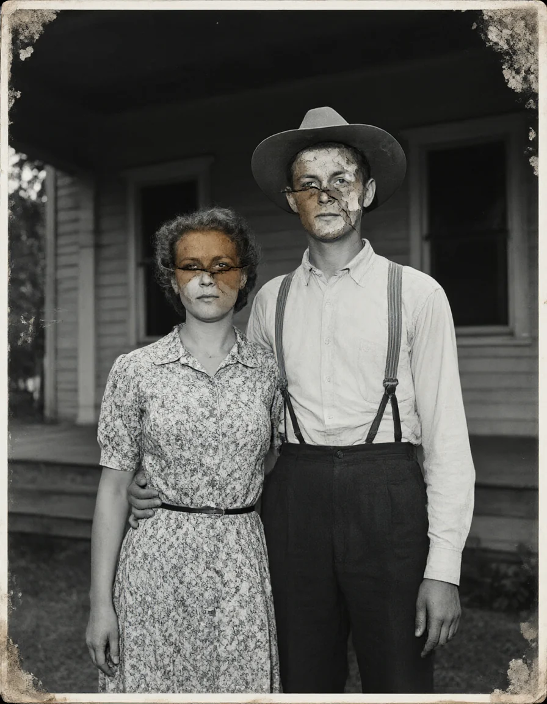<br>Before</td>
<td>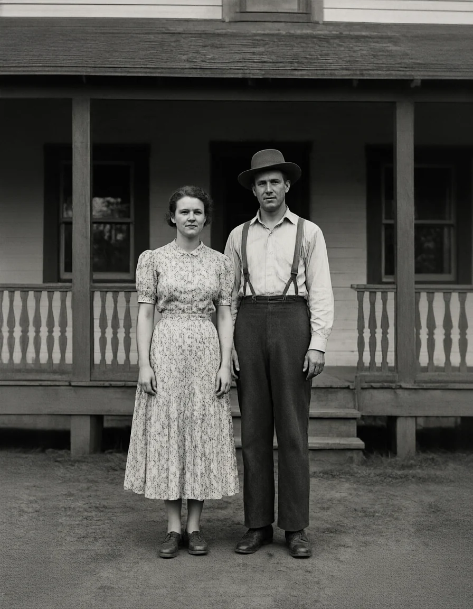<br>Restored</td>
<td>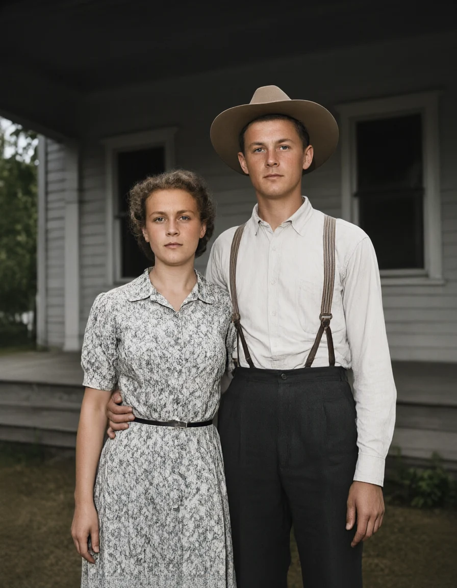<br>Restored and colorized</td>
</tr>
</table>

#### Make your own `Text in images`

Text in quotes in the prompt is written as given.

<table>
<tr>
<td></td>
<td>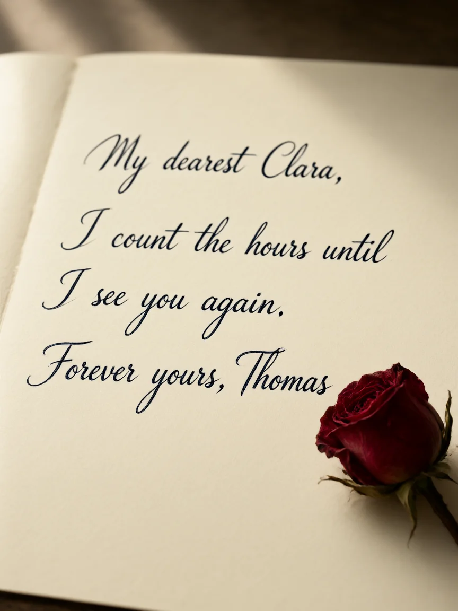</td>
<td></td>
</tr>
</table>

#### Make your own `Transparent PNG`

A transparent background straight from the prompt, or `remove_background` on any image. Hair, petals and soft edges
stay clean.

<table>
<tr>
<td>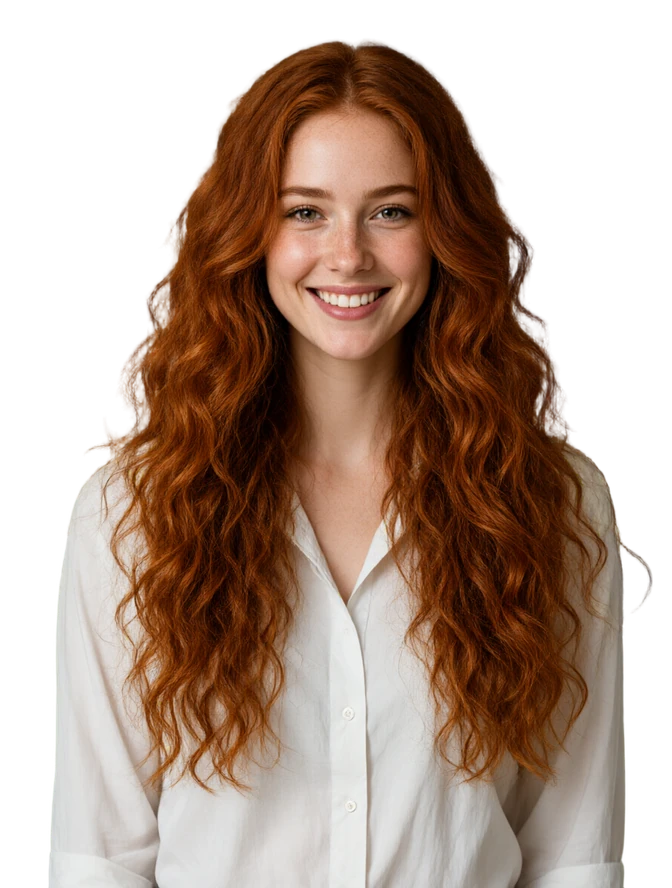</td>
<td>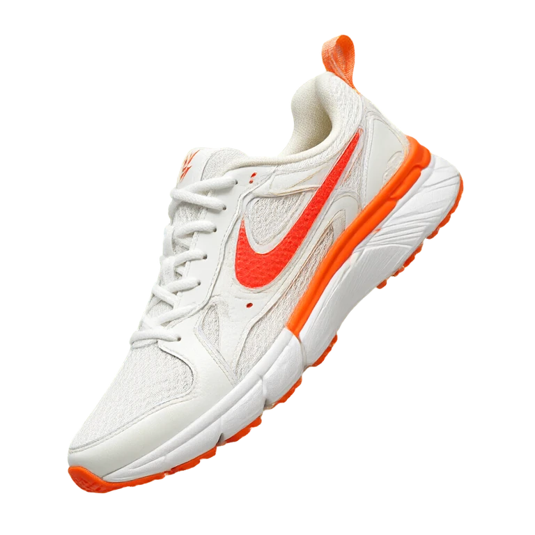</td>
<td></td>
</tr>
</table>

#### Make your own `Seamless texture`

Each tile (top) repeats with no seams (bottom, 3x3). Edits of a tile stay seamless, such as height and normal maps.

<table>
<tr>
<td></td>
<td></td>
<td></td>
</tr>
<tr>
<td></td>
<td></td>
<td></td>
</tr>
</table>

<br>
A stone tile, then a height map and a normal map made from it with an edit, each repeated 2x2.

#### Make your own `360 panorama`

A full 360 view, with a link to the built-in 360 viewer in the result. `image` turns a photo into a panorama.


#### Make your own `Upscale`

2x or 4x, up to 8192 px per side. Left: plain enlargement. Right: the upscaler.


#### Make your own `Watermark removal`

Watermarks, logos and overlaid text go; the rest of the image stays as it was.

<table>
<tr>
<td><br>Before (a test watermark added to the lighthouse)</td>
<td><br>After <code>remove_watermark</code></td>
</tr>
</table>

#### Make your own `SVG`

`generate_image`, then `vectorize_image`: a real SVG file, as your browser draws it. Logos, icons, lettering and line
art stay sharp at any size, and you can edit and recolor them in any vector app.

<table>
<tr>
<td>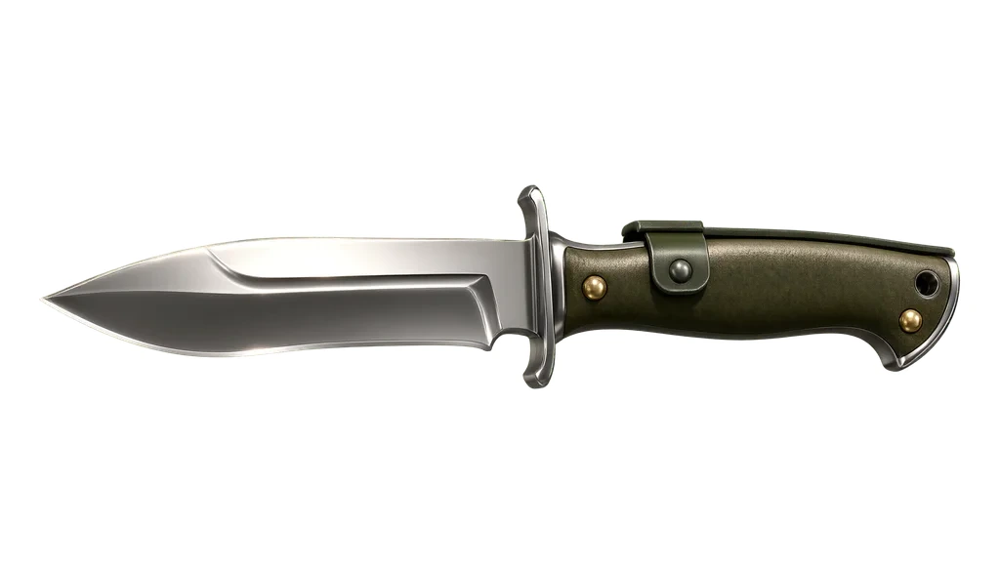<br>PNG</td>
<td>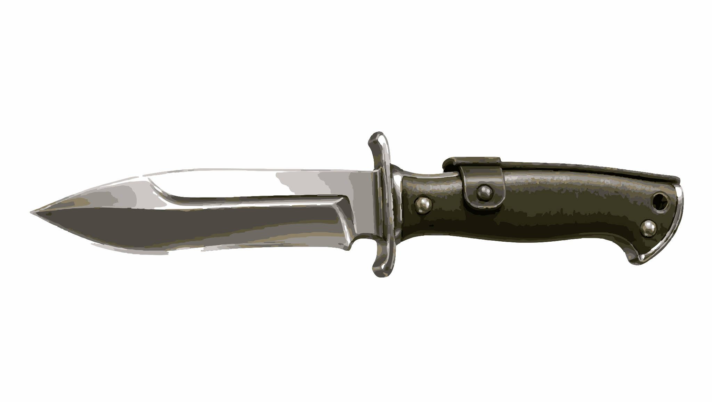<br>SVG (600 KB)</td>
</tr>
</table>

<table>
<tr>
<td><br>SVG, 2 colors</td>
<td><br>SVG, 4 colors</td>
</tr>
</table>

Each pair is a zoomed detail: the PNG on the left, the SVG on the right.

<table>
<tr>
<td><br>
Mascot, 4x</td>
<td><br>
Logo, 4x</td>
</tr>
<tr>
<td><br>
Line art, 4x</td>
<td><br>
Lettering, 3x</td>
</tr>
</table>

#### Make your own `Video`

5 to 20 seconds with sound, from text or from an image (here the 360 panorama). Click a preview for the full video
with sound. Needs the optional [video extension](#video-extension).

<table>
<tr>
<td><a href="docs/videos/cabin.mp4"></a><br>Text to video</td>
<td><a href="docs/videos/astronaut.mp4"></a><br>Text to video</td>
<td><a href="docs/videos/meadow.mp4"></a><br>Image to video</td>
</tr>
</table>

#### Make your own `Animation`

Transparent animations for games, apps and stickers: start from a transparent image and add `transparent: true`.
The result is a WebM with transparency and an animated WebP like these, which play over any background.

<table>
<tr>
<td><a href="docs/videos/anim-dragon-202.webm"></a></td>
<td><a href="docs/videos/anim-chest-202.webm">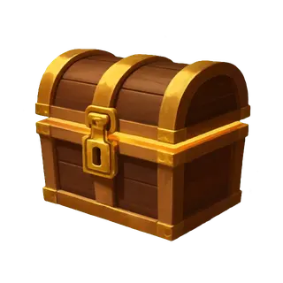</a></td>
<td><a href="docs/videos/anim-crystal-202.webm">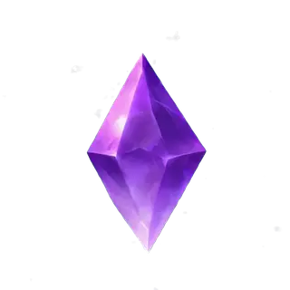</a></td>
<td><a href="docs/videos/anim-torch-101.webm">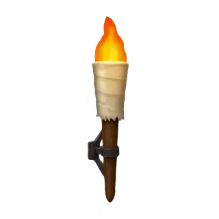</a></td>
</tr>
<tr>
<td><a href="docs/videos/anim-slime-202.webm"></a></td>
<td><a href="docs/videos/cauldron.webm"></a></td>
<td><a href="docs/videos/woman.webm"></a></td>
</tr>
</table>

#### Make your own `GIF`

`gif: true` on a new video, or `video_to_gif` on any video. A transparent video gives a transparent GIF.

<table>
<tr>
<td>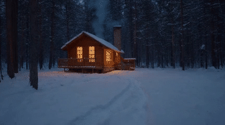<br>From a video</td>
<td><br>From a transparent animation</td>
</tr>
</table>

#### Prompts and settings

<details>
<summary>The prompts and settings of every image above</summary>

| Image | Tool and settings | Prompt |
|---|---|---|
| Text to image | `generate_image`, 1344x768, seed 20261006 | A lighthouse on a rocky coast at sunset, waves breaking on the rocks, warm golden light, a small fishing boat in the distance, dramatic clouds, photorealistic |
| Edit | `edit_image` with the image above, seed 7 | Make it a snowy winter night with the lighthouse beam switched on and snow on the rocks, keep everything else unchanged |
| Text in images | `generate_image`, 768x1024, seed 31 | A vintage travel poster, flat screen-print illustration of snowy mountains above a lake with a red train on a bridge, bold title text at the top that reads "SEE THE ALPS", smaller text at the bottom that reads "By rail, every season" |
| Love letter | `generate_image` with the Turbo model, 864x1152, seed 19 | A close-up photo of a handwritten love letter on cream paper, elegant flowing cursive in dark blue ink that reads "My dearest Clara," then "I count the hours until I see you again." then "Forever yours, Thomas", a dried red rose lying on the corner of the page, soft warm window light, shallow depth of field, photorealistic |
| Chalkboard menu | `generate_image` with the Turbo model, 864x1152, seed 8 | A cafe chalkboard menu hanging on a brick wall, neat hand-lettered white chalk with small colored chalk drawings of a coffee cup and leaves, the title reads "TODAY'S MENU", below it four lines that read "Espresso 2.50", "Cappuccino 3.75", "Croissant 3.00" and "Apple pie 4.25", photorealistic |
| Uncensored | `generate_image`, 768x1024, seed 505 | Iron Man in his red and gold armor standing on a rooftop at night, city lights below, cinematic lighting, photorealistic |
| Transparent | `generate_image` with the Turbo model, 896x1184, `transparent: true`, seed 7 | A young woman with very long, flowing, curly red hair, waist up, smiling, wearing a white shirt, soft studio light, photorealistic |
| Sneakers | `generate_image` with the Turbo model, 1024x1024, `transparent: true`, seed 21 | A pair of white and orange running sneakers floating in mid-air, one slightly above the other, dynamic angle, product photography, studio light, sharp detail |
| Bouquet | `generate_image` with the Turbo model, 1024x1024, `transparent: true`, seed 24 | A colorful bouquet of wildflowers and roses tied with a ribbon, full bouquet in view, photorealistic, soft light |
| 360 panorama | `generate_panorama`, 2048x1024, seed 2026 | A mountain meadow with wildflowers, a stone cabin, a wooden boardwalk and a lake |
| Brick | `generate_image`, 512x512, `tileable: true`, seed 111 | Large red bricks with light grey mortar, close-up, photorealistic, even lighting |
| Wood | `generate_image`, 512x512, `tileable: true`, seed 222 | Wide oak floor planks with visible wood grain and knots, top-down, natural light |
| Ceramic | `generate_image`, 512x512, `tileable: true`, seed 303 | Blue and white ceramic tiles with a floral pattern |
| Stone tile | `generate_image`, 512x512, `tileable: true`, seed 512 | A moss-covered stone floor, top-down |
| Height map | `edit_image` with the stone tile, seed 1 | Convert `<image1>` into a grayscale height map for a game material: white = high stone tops, black = low grout and gaps, keep the exact layout of every stone |
| Normal map | `edit_image` with the stone tile, seed 2 | Convert `<image1>` into a normal map for a game material, keep the exact layout of every stone |
| Watermark removal | `remove_watermark`, seed 9, on the text-to-image result with a tiled "SAMPLE" text and a corner badge added | - (no prompt needed) |
| Upscaling | `upscale_image`, `scale: 4` on the text-to-image result | - |
| Old photo (for the restoration) | `generate_image` with the Turbo model, 896x1152, seed 27 | A severely damaged old black and white photograph from the 1940s: a young couple standing in front of a wooden farmhouse porch, the woman in a floral dress, the man in a hat and suspenders, framed from the knees up so their faces are large. Heavy damage over their faces: a deep crack runs straight across both faces, a brown water stain covers half of the woman's face, the emulsion has peeled off one side of the man's face and hat, scratches and dust over their eyes. Also torn missing corners, mold spots and heavy fading, scanned photo |
| Restored | `edit_image` with the old photo, Turbo model, seed 5 | Restore this old photograph: remove every scratch, crease, stain, dust spot and the torn corner, fill in the missing parts, fix the faded contrast, keep it black and white. Keep the people, their faces, poses and clothes and the whole composition exactly the same |
| Restored and colorized | `edit_image` with the old photo, Turbo model, seed 5 | Restore and colorize this old photograph: remove every scratch, crease, stain, dust spot and the torn corner, fill in the missing parts, and add natural realistic colors. Keep the people, their faces, poses and clothes and the whole composition exactly the same |
| Image to SVG | `vectorize_image` on the knife, the badge, the tiger, the mascot, the rose and the logo | - |
| Mascot (for the SVG) | `generate_image` with the Turbo model, 1024x1024, seed 105 | An esports mascot logo: a fierce eagle head, thick black outlines, flat colors in blue, yellow and white, flat vector art, solid colors, no gradients, no shadows, plain white background, centered |
| Rose (for the SVG) | `generate_image` with the Turbo model, 1024x1024, seed 121 | A tattoo flash design of a rose, black line art, clean bold lines, white background |
| Coffee logo (for the SVG) | `generate_image` with the Turbo model, 1024x1024, seed 102 | A coffee shop logo "BEAN THERE": a coffee cup with heart-shaped steam and the name below, brown, flat vector art, solid colors, no gradients, no shadows, plain white background, centered |
| Knife (for the SVG) | `generate_image` with the Turbo model, an earlier image (its prompt was not kept) | - |
| Coffee badge (for the SVG) | `generate_image` with the Turbo model, 1024x1024, seed 32 | A retro badge logo for 'MOUNTAIN COFFEE CO.': a coffee cup in front of snowy mountains and sun rays inside a circle, the name written around the circle, two colors, dark brown and cream, flat vector art, no gradients, centered, plain white background |
| Tiger (for the SVG) | `generate_image` with the Turbo model, 1024x1024, seed 34 | An esports mascot logo: a roaring tiger head, thick black outlines, flat colors in orange, white and black, flat vector art, no gradients, no shadows, plain white background, centered |
| Cabin | `generate_video`, 16:9, seed 202 | Wide shot of a small wooden cabin in a snowy pine forest at night, its windows glowing warm orange. The camera pushes in slowly toward the cabin. Snow falls gently from the sky, and gray smoke rises from the stone chimney and drifts to the right. The pine trees and the cabin stay still. Moonlight, cozy, realistic. Audio: soft wind, quietly a crackling fire. No dialogue, no music. |
| Astronaut | `generate_video`, 16:9, seed 101 | Wide shot of an astronaut in a white spacesuit walking slowly across red sand dunes on Mars, toward the camera. The camera is static. Each step kicks up small clouds of red dust that drift to the left. A pale sun is low in the dusty orange sky behind the astronaut. Realistic, cinematic. Audio: loudly, slow breathing inside the helmet; crunching footsteps; a thin wind. No dialogue, no music. |
| Meadow | `generate_video` with the 360 panorama, 16:9, seed 202 | A mountain meadow with wildflowers, a stone cabin, a wooden boardwalk and a lake. The camera pans slowly to the right across the meadow. The wildflowers and the grass sway in a light breeze, small clouds drift slowly over the mountains, and the lake ripples. Bright summer daylight, realistic. Audio: a light breeze, bees, birdsong. No dialogue, no music. |
| Dragon | `generate_image` with the Turbo model, 1024x1024, `transparent: true`, seed 11; then `generate_video` with it, `transparent: true`, `sound: false`, seed 202 | Image: A cute cartoon baby dragon sitting, purple scales, small orange wings, big friendly eyes, little horns, game asset, stylized hand-painted 3D look, soft cel shading, bold readable shapes, full object in view, centered<br>Video: Full view of the cute cartoon baby dragon sitting. The camera is static. It flaps its small orange wings twice, blinks, then opens its mouth and puffs a small burst of orange flame upward that quickly fades. It stays sitting in place at the same size. |
| Treasure chest | `generate_image` with the Turbo model, 1024x1024, `transparent: true`, seed 14; then `generate_video` with it, `transparent: true`, `sound: false`, seed 202 | Image: A closed wooden treasure chest with gold trim and a gold lock, warm golden light leaking from the gap under the lid, three-quarter view, game asset, stylized hand-painted 3D look, soft cel shading, bold readable shapes, full object in view, centered<br>Video: Three-quarter view of the wooden treasure chest. The camera is static. The lid slowly opens upward and bright golden light pours out of the chest, with small golden sparkles rising from inside. The chest stays in place at the same size. |
| Crystal | `generate_image` with the Turbo model, 1024x1024, `transparent: true`, seed 16; then `generate_video` with it, `transparent: true`, `sound: false`, seed 202 | Image: A glowing purple magic crystal with sharp facets, floating, small sparkles around it, game asset, stylized hand-painted 3D look, soft cel shading, bold readable shapes, full object in view, centered<br>Video: Full view of the purple magic crystal. The camera is static. The crystal floats and bobs gently up and down in place, slowly rotating, its glow pulsing brighter and dimmer, while small sparkles twinkle around it. |
| Torch | `generate_image` with the Turbo model, 1024x1024, `transparent: true`, seed 13; then `generate_video` with it, `transparent: true`, `sound: false`, seed 101 | Image: A medieval wall torch, a wooden handle wrapped in cloth with an iron bracket, a bright orange flame on top, game asset, stylized hand-painted 3D look, soft cel shading, bold readable shapes, full object in view, centered<br>Video: Full view of the wall torch. The camera is static. The orange flame on top flickers and dances, growing taller and smaller, and small glowing sparks float up and fade. The wooden handle and the iron bracket stay still. |
| Slime | `generate_image` with the Turbo model, 1024x1024, `transparent: true`, seed 15; then `generate_video` with it, `transparent: true`, `sound: false`, seed 202 | Image: A cute glossy blue slime monster with big eyes and a small smile, round jelly body, game asset, stylized hand-painted 3D look, soft cel shading, bold readable shapes, full object in view, centered<br>Video: Full view of the cute blue slime monster. The camera is static. It bounces up and down in place, squashing flat when it lands and stretching tall when it rises, wobbling like jelly, and it blinks happily. It stays centered at the same size. |
| Cauldron | `generate_image` with the Turbo model, 512x512, `transparent: true`, seed 1779312852; then `generate_video` with it, `transparent: true`, `sound: false`, seed 1835987638 | Image: Game UI asset, isolated icon of a witch's brewing bowl: a squat black iron cauldron-style bowl with three short claw feet, a thick rolled rim, a single curved handle on the right side, weathered pitted metal with dull green-bronze patina highlights. Filled to the brim with glowing toxic green potion whose surface is covered in round bubbles of different sizes, some bursting into small droplet sprays. Three wispy curls of translucent pale-green steam rising from the surface, drifting upward and thinning out at the top. Stylized hand-painted video game art, thick readable shapes, soft cel shading, crisp rim light from the glowing liquid, slight top-down three-quarter view, centered composition. Double-quoted text: none.<br>Video: Camera completely static and locked off, wide shot matching the first frame exactly: the whole black iron cauldron bowl is visible and centered, including its round body, its rolled rim, the ring handle on the right and its three short claw feet at the bottom. Do not zoom, do not crop, do not pan, no camera movement at all. Only the liquid and steam move: round green bubbles slowly swell up to the surface and pop with tiny splashes, thin translucent green steam wisps curl upward and fade near the top, a few small droplets arc up and fall back, and the green glow pulses gently. Everything else stays exactly as in the first frame. |
| Woman (animation) | `generate_video` with the transparent image above, `transparent: true`, `sound: false`, seed 77 | Medium close-up, waist-up portrait of the young woman with long curly red hair. The camera is static. She looks straight into the camera with a calm, gentle smile; she does not speak and her lips stay closed. She blinks slowly two times, about two seconds apart. Her head and shoulders stay still and she stays centered in the frame; a light breeze moves a few strands of her hair. |
| GIFs | `video_to_gif` on the cabin video (`width: 320`, `fps: 8`) and on the slime WebM (`width: 320`, `fps: 10`) | - |

Characters and brands shown belong to their owners.

</details>

## Quick start

New to Docker or MCP? [Getting started](docs/getting-started.md) shows each step of the setup, each choice and
what the screens mean.

1. Install Docker (see [Requirements](#requirements)) and start it. On Windows, open Docker Desktop and wait
   until it shows that it is running.
2. Download this project with [Git](https://git-scm.com/downloads):

   ```bash
   git clone https://github.com/hypersniper05/MCP-Image-Generator-Uncensored.git
   cd MCP-Image-Generator-Uncensored
   ```

   Without Git: on GitHub click **Code > Download ZIP** and unzip it (updates then mean downloading it again).
3. Run the start script from that folder:
   - **Windows**: double-click `start.cmd`
   - **Linux**: run `./start.sh`
   - **Mac**: double-click `start.command` (CPU only for now, see [Mac](docs/mac.md))
4. The first start runs the setup. It asks which GPU (when there are several) and which model to use (see
   [Choosing a model](#choosing-a-model)). It sets the GPU memory settings for you. If you are not sure, press
   Enter to take the recommended choice (Turbo). Choose 1 or 2 for the Non-Turbo model.
   [Getting started](docs/getting-started.md#the-first-start) explains each choice.
5. Wait. The first start builds the Docker image (10-30 minutes, 16 on a fast PC). Then it downloads 11-16 GB of
   models into the `models` folder (Turbo: 13 minutes on a 1 Gbps line). When it is ready, the script prints the
   address:

   ```
   Ready. Add this address to your AI app as an MCP server:
       http://localhost:5005/mcp
   ```

6. Add that address to your MCP client (see [Connect an MCP client](#connect-an-mcp-client)).

- **Change the model or the GPU**: run `setup.cmd` (Windows) or `./setup.sh` (Linux). Your current settings are
  the defaults, so Enter keeps them.
- **Update**: run `update.cmd` or `./update.sh`. Your settings and model files are kept.
- **Stop**: `stop.cmd` or `./stop.sh`. **Logs**: `docker compose logs -f`.
- **A message you do not understand**: see [When something goes wrong](docs/getting-started.md#messages).
- **Web gallery**: open `http://localhost:5005/` (see [The web gallery](#the-web-gallery)).
- **Model files** are saved in the `models` folder. After you change the model, the old files stay there:
  delete the ones you no longer use to free disk space.
- **Settings**: your choices are saved in `config.yaml` (created from
  [`config.example.yaml`](config.example.yaml)).
- **Updates by hand**: `git pull`, then `./start.sh --build` (or `start.cmd -Build`).

<details>
<summary>Start without the scripts</summary>

```bash
cp config.example.yaml config.yaml
cp .env.example .env                  # for CPU mode, set COMPOSE_PROFILES=cpu in .env
docker compose up -d --build
```

</details>

> **Security note.** The server is open by design, so it is easy to connect to: it has **no login**, it
> listens on all network interfaces, and it accepts requests from any web page. Anyone who can reach port 5005
> can make images, see every image on the server and delete images from its web page, and so can a web page open
> in a browser on your network (except deleting: only the server's own page can do that).
> Run it on your own computer or a network you trust, use a VPN such as Tailscale for remote access, and never
> forward the port to the internet.

## The web gallery

Open `http://localhost:5005/` in a browser on your network.

<table>
<tr>
<td width="50%">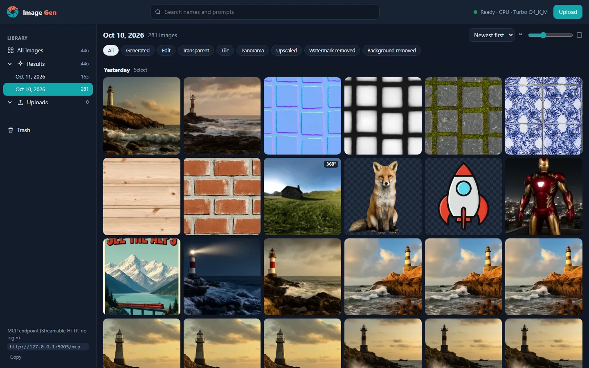</td>
<td width="50%">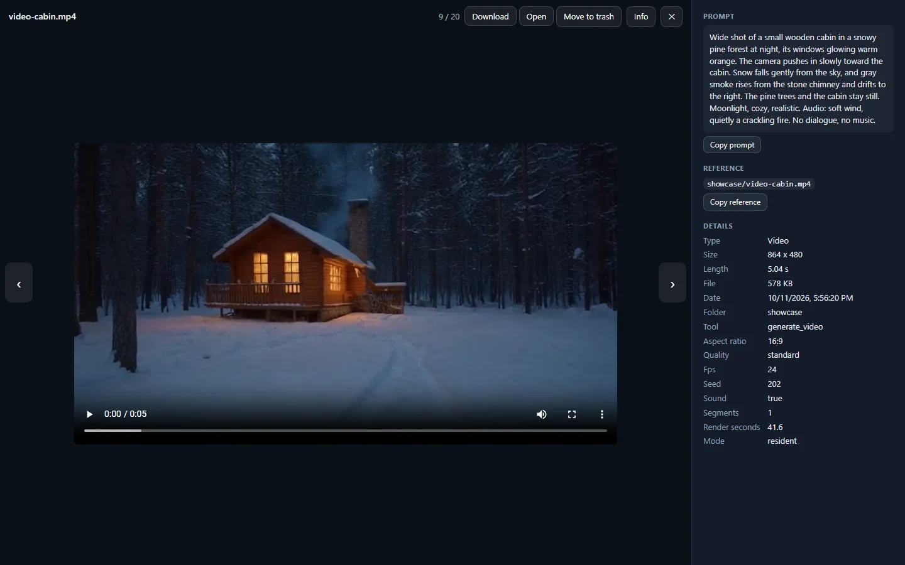</td>
</tr>
</table>

- Every image and video on the server, by folder and day. Search names and prompts, filter by type (generated,
  edit, transparent, tile, panorama, upscaled, SVG, video, GIF, animation, upload) and sort by date, name or size.
  Videos play in the viewer.
- Select many images (their check marks, Ctrl+click, Shift+click for a range, Ctrl+A), then download them as a zip
  or move them to the trash. Undo brings them back, and so does the trash until you empty it or the outputs cleanup
  removes old files (`outputs.keep_days`).
- Click an image to see it full size with its prompt and settings, and copy its reference for your AI app.
- Drop images on the page to upload them as inputs for edits.

To stop the page from deleting images, set `outputs.allow_delete: false` in `config.yaml`.

## Turbo or Non-Turbo

The choice is yours during the setup.

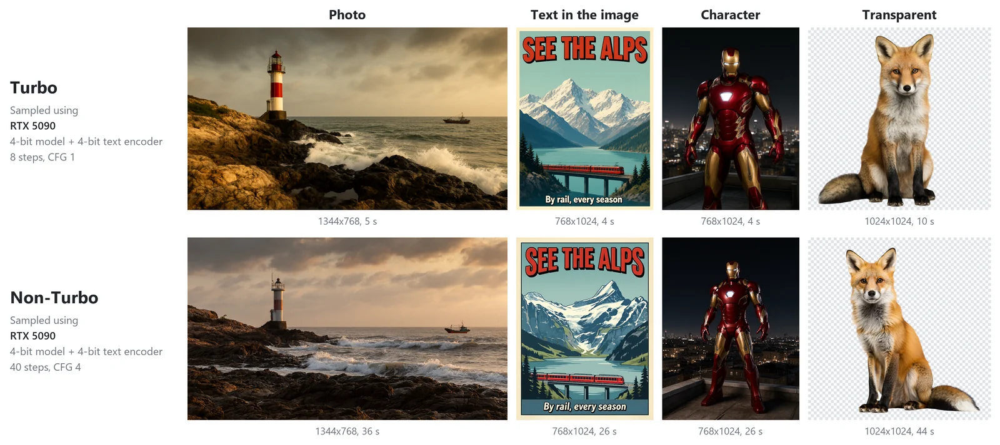

| | Turbo | Non-Turbo |
|---|---|---|
| Model | Official Qwen-Image-2.1-Turbo, 8 steps, CFG 1 | Qwen-Image-2.1 in a GGUF build that keeps its quality at 4-bit, 40 steps, CFG 4 |
| 1344x768 photo, RTX 5090 32 GB | 5.1 s | 36.2 s |
| 1024x1024 image, RTX 3080 Ti 12 GB | 11.4 s | about 90 s |
| 1024x1024 image, Mac M5 Max (native, in development) | 48 s | 7.6 min |
| Small text | Weak in small images (512x512 and less) | Good |

**Recommended setup: Turbo Q4_K_M with the Q4_K_M text encoder.** The setup recommends it, so Enter picks it. It
downloads 11.4 GB. The whole model needs about 14 GB of GPU memory. For the Non-Turbo model, choose 1 or 2 in the
setup.

With less GPU memory, the server keeps more weights in RAM. On the same GPU this costs little time from 8 GB, and
4-6 GB takes about 2 times longer. An older GPU or a slow PCIe slot is slower again: see [GPU memory](#gpu-memory).

Turbo, seconds per image:

| Job | RTX 5090 32 GB, everything in GPU memory | RTX 3080 Ti 12 GB, text encoder in RAM |
|---|---|---|
| Photo, 1344x768 | 5.1 | 11.5 |
| Poster, 768x1024 | 3.9 | 9.0 |
| Transparent, 1024x1024 | 10-13 | 17-19 |
| Edit, 1344x768 | 10.7 | 18.2 |
| Watermark removal, 1344x768 | 8.9 | 18.9 |
| 360 panorama, 2048x1024 | 22 | 46 |
| Seamless tile, 512x512 | 1.8 | 3.9 |
| xl, about 4 megapixels | 30-39 | 64-74 |
| GPU memory used | about 15 GB (edits about 17 GB) | up to 10.1 GB (watermark removal 10.5 GB) |

The 3080 Ti uses the limit that the setup sets: 10 GB. Smaller GPUs: see [GPU memory](#gpu-memory).

**Mac**: on a MacBook Pro M5 Max, Docker uses only the CPU, and Turbo took 148 s at 512x512. The native version for
the Apple GPU, in development, took 11 s at 512x512, 48 s at 1024x1024 and 69 s for an edit. See [Mac](docs/mac.md).

**First install**: about 30 minutes on a fast PC with a 1 Gbps line. The build took 16 minutes (10-30 minutes,
depending on the CPU), and the Turbo download (11.4 GB) took 13 minutes. After that, the server is ready about 35 s
after a start.

## Requirements

| | GPU mode | CPU mode |
|---|---|---|
| Docker | Docker Desktop (Windows) or Docker Engine with Compose (Linux) | Docker Desktop (Windows, Mac) or Docker Engine with Compose (Linux) |
| Hardware | NVIDIA GPU, GTX 16xx / RTX 20xx or newer, 4 GB of GPU memory (VRAM) or more (see [GPU memory](#gpu-memory)), 32 GB RAM recommended | Any modern 64-bit CPU, 24 GB RAM or more |
| Driver | NVIDIA driver 570 or newer | - |
| Disk | 12-16 GB for models (see [Choosing a model](#choosing-a-model)) and 6 GB for the Docker image | 12-16 GB and 1 GB |

**GPU setup**

- **Windows**: install [Docker Desktop](https://docs.docker.com/desktop/setup/install/windows-install/) with the
  WSL 2 backend and a current NVIDIA driver.
- **Linux**: install the NVIDIA driver and the
  [NVIDIA Container Toolkit](https://docs.nvidia.com/datacenter/cloud-native/container-toolkit/latest/install-guide.html).

Check that Docker can see your GPU:

```bash
docker run --rm --gpus all nvidia/cuda:12.8.2-base-ubuntu24.04 nvidia-smi
```

### GPU memory

The setup sets everything for your GPU. Choose one GPU and the model goes on it. What does not fit stays in RAM: the
engine decides this by itself. On a 12 GB GPU, for example, it keeps the text encoder's weights in RAM.

Docker on a Mac uses only the CPU and RAM, with no GPU: see [Mac](docs/mac.md).

Turbo, seconds per image, with what the setup sets for each GPU size:

| GPU memory | 1344x768 | 1024x1024 | 512x512 | GPU memory used |
|---|---|---|---|---|
| 4 GB (estimate) | 22.3 | 22.9 | 6.5 | 2.5 GB |
| 6 GB (estimate) | 21.4 | 21.7 | 4.8 | 4.5 GB |
| 8 GB (estimate) | 11.8 | 12.4 | 3.9 | 5.9 GB |
| 10 GB | 11.8 | 12.4 | 3.9 | 5.9 GB |
| 12 GB | 11.4 | 11.4 | 3.8 | 9.8 GB |

All rows come from one RTX 3080 Ti, with the memory limit that the setup sets for each GPU size. They show the cost
of less memory, not of a slower GPU. So the 4-8 GB rows are estimates: a real card of that size is slower.

**An old PC is much slower.** On a real GTX 1650 4 GB, one image took 618 s at 1344x768, 632 s at 1024x1024 and
110 s at 512x512, using 2.2 GB of GPU memory. The GTX 1650 has about 11 times less FP32 compute than an RTX 3080 Ti
(3 against 34 TFLOPS) and no tensor cores. That PC also had 16 GB of DDR3 RAM and a hard disk. Docker had 12 GB of that RAM, so the server read
the text encoder from the disk for each image.

### Split the model over GPUs and the CPU

The model has three parts. Each part can run on a different GPU, or on the CPU. With two or more GPUs, choose
`Custom load (multi-GPU and CPU)` in the setup (see [Custom load](docs/getting-started.md#custom-load)). With one
GPU, set the parts in `config.yaml` (see [Choosing GPUs](#choosing-gpus)).


- In Custom load, the setup recommends the text encoder in RAM on a GPU with 12-19 GB. Its weights (5.0 GB, or 8.7 GB
  with the Q8_0 file) then stay out of GPU memory (on a 12 GB GPU, the engine also does this by itself). On a GPU
  with 8-11 GB this was slower (19.4 s against 11.8 s at 1344x768), so the setup does not recommend it there.
- The image decoder on the CPU makes each image much slower. Use it only when no GPU has room.

## Choosing a model

The setup asks which model to use (the first start runs it). Run `setup.cmd` or `./setup.sh` at any time to
change it.

| | Setup choice | Model | Text encoder | Download | One 1024x1024 image | GPU memory used | RAM used |
|---|---|---|---|---|---|---|---|
| 1 | Best quality | Non-Turbo, 40 steps: Q4_K_M, 4-bit (4.6 GB) | Q8_0, 8-bit (8.7 GB) | 15.5 GB | 89 s | up to 10 GB (the limit) | about 18 GB (estimate) |
| 2 | Standard | Non-Turbo, 40 steps: Q4_K_M, 4-bit (4.6 GB) | Q4_K_M, 4-bit (5.0 GB) | 11.8 GB | 89 s | up to 10 GB (the limit) | about 14 GB |
| 3 | **Turbo** (recommended) | Turbo, 8 steps: Q4_K_M, 4-bit (4.2 GB) | Q4_K_M, 4-bit (5.0 GB) | 11.4 GB | 11 s | 9.8 GB | about 11 GB |

- **Time, GPU memory and RAM**: one 1024x1024 image on an RTX 3080 Ti 12 GB, with the 10 GB limit that the setup
  sets for it. What does not fit in GPU memory stays in RAM.
- **GPU**: Turbo runs on a GPU with 4 GB or more. For Non-Turbo, use a GPU with 12 GB or more: it makes 40 steps per
  image, so it gets slow when its weights stay in RAM.
- **Memory for Docker**: 16 GB for Turbo and Standard, 20 GB for Best quality. The setup checks this.
- **Mac**: on an M5 Max with the native version in development, one 1024x1024 image took 48 s with Turbo and 7-7.6
  minutes with Non-Turbo. See [Mac](docs/mac.md).
- **Download**: each one includes 2.2 GB of files that every choice needs (the text encoder's vision file, the image
  decoder, background removal, watermark removal, upscaler).

Turbo is the official Qwen-Image-2.1-Turbo: it is much faster, but weaker at small text and at following long
prompts. Non-Turbo is Qwen-Image-2.1 in a GGUF build by abenzerps, chosen because it keeps its quality well at 4-bit.

<a href="docs/images/model-comparison.webp">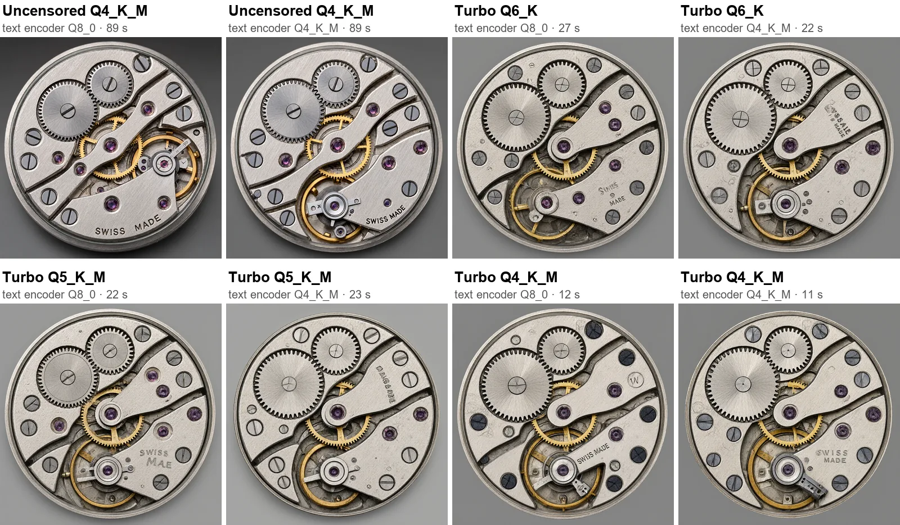</a><br>
<b>Same prompt and seed with each combination</b> (click to see full size). The Non-Turbo model with the Q8_0
text encoder gave the best quality. On a 12 GB card, the larger Turbo files (Q5_K_M, Q6_K) were slower than
Q4_K_M because they do not fit as well.

To pick another combination, set `model.variant`, `model.quant` and `model.text_encoder_quant` in
`config.yaml`. [`config.example.yaml`](config.example.yaml) lists the sizes. Then run the start script again and
let it restart the server.

## Connect an MCP client

The endpoint is `http://<host>:5005/mcp` (Streamable HTTP).

**MCP Inspector** (quick test in a browser): run `npx @modelcontextprotocol/inspector`, choose
*Streamable HTTP*, enter `http://localhost:5005/mcp` and click *Connect*.

**VS Code** (`.vscode/mcp.json`):

```json
{ "servers": { "imagegen": { "type": "http", "url": "http://localhost:5005/mcp" } } }
```

**Cursor** (`~/.cursor/mcp.json`) and most other clients:

```json
{ "mcpServers": { "imagegen": { "url": "http://localhost:5005/mcp" } } }
```

**Claude Code**: run this once in a terminal:

```bash
claude mcp add --transport http imagegen http://localhost:5005/mcp
```

**Clients that only support stdio** can connect through [mcp-remote](https://www.npmjs.com/package/mcp-remote):

```json
{ "mcpServers": { "imagegen": { "command": "npx", "args": ["-y", "mcp-remote", "http://localhost:5005/mcp", "--allow-http"] } } }
```

Large images take minutes. If an image is not ready within 25 seconds, the tool returns a `job_id` and the
client gets the image with `get_job`, so clients with short time limits still work. To wait longer per call, add
`?max_wait=N` to the endpoint URL (in seconds, at most 280; keep it under your client's tool time limit).

<details>
<summary>llama.cpp web UI and optional request headers</summary>

For the llama.cpp web UI (llama-server started with `--ui-mcp-proxy`), add the server in the web UI's MCP
settings, or for every browser through the file passed with `--ui-config-file`:

```json
{
  "mcpServers": "[{\"id\": \"imagegen\", \"name\": \"Image Gen\", \"url\": \"http://127.0.0.1:5005/mcp\", \"enabled\": true, \"useProxy\": true, \"headers\": \"{\\\"X-Imagegen-Max-Wait\\\": \\\"20\\\", \\\"X-Inline-Max-Bytes\\\": \\\"16000000\\\"}\"}]"
}
```

Optional headers a client can send:

| Header | Effect |
|---|---|
| `X-Imagegen-Max-Wait: 20` | How long a call waits before returning a `job_id` (default 25, at most 280); the same as `?max_wait=N` |
| `X-Inline-Max-Bytes: 16000000` | Send the full image inline instead of a preview (for clients without a message size limit) |
| `X-Imagegen-Inline: data-uri-text` | Return images as data-URI text, for clients that drop MCP image content |
| `X-Forwarded-Host: 192.168.1.50:5005` | Host name to use in returned links when the client connects through a proxy |

</details>

## Tools

| Tool | What it does |
|---|---|
| `generate_image` | Text to image. Options: `size` (`small`, `medium`, `large`, `xl`) or `width` and `height`, `aspect_ratio`, `transparent`, `tileable`, `seed`, `steps`, `negative_prompt` |
| `edit_image` | Edit one image or combine up to 10 (refer to them as `<image1>`, `<image2>`, ...). Optional `mask`. Edits of a seamless tile stay seamless and keep its size |
| `generate_panorama` | 360 panorama (2:1). Optional `image` to turn a photo into a full 360 |
| `remove_background` | Cut out the subject into a transparent PNG |
| `upscale_image` | Enlarge 2x or 4x (up to 8192 px per side). Panoramas and tiles stay seamless |
| `remove_watermark` | Remove watermarks, logos and overlaid text; the rest of the image is kept as it was |
| `vectorize_image` | Convert a logo, icon or line art to an SVG vector file. `preset`: `auto`, `logo`, `icon`, `illustration` or `bw`. Photos become a posterized SVG |
| `get_job`, `cancel_job` | Get the result of, or cancel, a job that was still running |
| `list_images`, `view_image` | Recent results and uploads, and a way for the model to look at one |
| `server_status` | Model, GPU placement, download progress and running jobs |
| `generate_video`, `extend_video`, `video_to_gif` | Video with sound from text or an image, longer videos from a short one, and animated GIFs. Only with the [video extension](#video-extension) |

**Input images** can be a data URL or base64, an `http(s)` URL, a file name or link of an image this server
made, or an image uploaded on the server's web page (`http://<host>:5005/upload`).

**Results** include the image (or a preview of a large one) and a link to the full file, which is saved in
`./outputs`. Panoramas also get a link to the 360 viewer, and `vectorize_image` a link to the SVG file.

**Tips**

- For the best quality use `size: "xl"`. Leave `steps` and `cfg_scale` unset.
- Write full sentences: subject, setting, lighting, style. Put text that should appear in quotes:
  `a neon sign that says "OPEN 24/7"`.
- For edits, say what to change and add "keep everything else unchanged".
- For tiles, describe a surface or pattern that fills the whole picture, e.g. "moss-covered cobblestones,
  top-down".

## Video extension

An optional extension makes **5 to 20 second videos with sound** from a text description or from an image, and
transparent animations for games and UIs, and GIFs. It uses
[Kandinsky 6 Lite](https://huggingface.co/kandinskylab/Kandinsky-6.0-Lite-distill-5s-Diffusers) in a 4-bit version,
runs in its own container in `extensions/kandinsky6/`, and its tools appear on the same MCP address as the image
tools. The setup asks whether to install it. To uninstall it, run the setup again and answer no.

Kandinsky 6 Lite is a small model (3 billion parameters). It does best with calm motion that needs no physics: idle
loops, steam, flames, blinking, small gestures and slow camera moves. Fast action and things that collide or
interact often go wrong.

**In the works:** an extension for [MiniMax-H3](https://huggingface.co/MiniMaxAI/MiniMax-H3), a large video model (33
billion parameters) that handles fast action and complex motion, for GPUs with more memory.

See [Kandinsky 6 video](docs/kandinsky6.md) for the samples, the options, how to prompt, the token limits, and the
speed and memory on different GPUs.

## Configuration

All settings are in `config.yaml` (created from the commented [`config.example.yaml`](config.example.yaml)).
After a change, run the start script again and let it restart the server. The most useful ones:

| Setting | Default | What it does |
|---|---|---|
| `device` | `gpu` | `gpu` or `cpu` |
| `model.variant`, `model.quant`, `model.text_encoder_quant` | `uncensored`, `Q4_K_M`, `Q4_K_M` | The model: see [Choosing a model](#choosing-a-model). `setup.cmd` (Windows) or `./setup.sh` (Linux) changes these |
| `generation.steps` | 40 | Steps of the Non-Turbo model: quality vs. speed. 25 is a faster draft. Turbo always uses 8 |
| `generation.default_size` | 1024x1024 | Size when a request gives none |
| `generation.panorama_size` | 2048x1024 | Default panorama size (2880x1440 at most) |
| `generation.wait_seconds` | 25 | How long a tool call (and each `get_job`) waits before returning a `job_id` (at most 280) |
| `generation.idle_unload_seconds` | 0 | Free the GPU memory after this many idle seconds (0 = keep loaded) |
| `outputs.keep_days` | 7 | Delete old results after this many days (0 = never) |
| `server.port` | 5005 | Port of the server |
| `server.public_url` | empty | Address used in returned links, e.g. `http://192.168.1.50:5005` |
| `extensions.enabled`, `extensions.max_jobs` | `[]`, `auto` | Installed extensions (the setup writes this), and how many GPU jobs run at once. See [Video extension](#video-extension) |

`.env` (created from [`.env.example`](.env.example)) holds Docker settings such as `PUBLIC_URL`, `HF_TOKEN`
(only needed if Hugging Face rate-limits your downloads) and the build options.

`config.yaml` and `.env` are your local files and are not part of the repository.

## Choosing GPUs

GPU numbers are the ones `nvidia-smi` shows. Everything runs on GPU 0 by default. The model has three parts,
and each can go on a different GPU. The setup can do this for you: choose `Custom load (multi-GPU and CPU)`
(see [Getting started](docs/getting-started.md#custom-load)). By hand, in `config.yaml`:

```yaml
gpu:
  diffusion: [0]     # the image model: runs every step, use the fastest GPU
  text_encoder: 1    # reads the prompt once per request
  vae: 0             # the image decoder: turns the result into pixels
```

On a shared computer, only the GPUs you list are used. For cards with less memory, see
[GPU memory](#gpu-memory).

## Troubleshooting

- **No GPU found**: run the `nvidia-smi` check from [Requirements](#requirements). On Linux, install the NVIDIA
  Container Toolkit. Or use `device: cpu`.
- **Out of GPU memory**: run the setup again and choose Turbo, use a smaller size, or move a part of the model to
  another GPU (see [Split the model over GPUs and the CPU](#split-the-model-over-gpus-and-the-cpu)).
- **The client times out**: add `?max_wait=N` to the endpoint URL (or lower `generation.wait_seconds`) with N below the client's tool time limit.
- **Other computers cannot connect**: use this computer's IP address instead of `localhost`, allow port 5005
  in the firewall, and set `server.public_url` so image links work.
- **CPU mode or the Q8_0 text encoder is very slow or crashes on Windows**: Docker Desktop gives WSL only half
  your RAM. Raise it in `%UserProfile%\.wslconfig` (`[wsl2]` then `memory=24GB`), run `wsl --shutdown` and
  restart Docker Desktop.
- **Images fail with "lost the connection to the inference engine"**: the engine stopped, usually because it ran
  out of memory. Give Docker more memory (see the Windows item above) or choose a smaller model.
- **The server shows an error**: read `docker compose logs --tail 100`, fix the cause, and run the start
  script again. [Getting started](docs/getting-started.md#messages) lists the messages of the
  scripts and what to do.

## Development

```bash
python -m venv .venv && . .venv/bin/activate
pip install -e ".[test]"
pytest
```

`python -m imagegen_mcp --config config.yaml --check` validates a config file without starting anything.
`python scripts/smoke_test.py http://localhost:5005/mcp` tests a running server.

Images are made by [stable-diffusion.cpp](https://github.com/leejet/stable-diffusion.cpp), built inside the
Docker image from a pinned release with one small patch
([`docker/patches/sdcpp-circular-json.patch`](docker/patches/sdcpp-circular-json.patch)) that turns on its
wrap-around mode per request for tileable images.

## Contribute

* Bug reports and ideas: [open an issue](https://github.com/hypersniper05/MCP-Image-Generator-Uncensored/issues).
* Pull requests are welcome. Run the tests first: see [Development](#development).

## Origins & License

[](LICENSE)

The code in this repository is MIT licensed (see [LICENSE](LICENSE)). It builds on the work of others; the
model files are downloaded from their original sources and keep their own licenses:

| Part | By | License |
|---|---|---|
| [Qwen-Image-2.1](https://huggingface.co/Qwen) image model | Qwen team, Alibaba | Qwen Research License (**non-commercial**) |
| [Uncensored Qwen-Image-2.1 GGUF](https://huggingface.co/abenzerps/Qwen-Image-2.1-Uncensored-GGUF) (the Non-Turbo model files) | abenzerps | Qwen Research License (**non-commercial**) |
| [Qwen-Image-2.1-Turbo GGUF](https://huggingface.co/AtomicChat/Qwen-Image-2.1-Turbo-GGUF) (the Turbo model files) | AtomicChat | Qwen Research License (**non-commercial**) |
| [Texture-fix VAE](https://huggingface.co/madebyollin/texture-fix-vae-for-qwen-image-2.1) (image decoder) | madebyollin | Qwen Research License (**non-commercial**) |
| [Qwen3-VL-8B-Instruct GGUF](https://huggingface.co/Qwen/Qwen3-VL-8B-Instruct-GGUF) (prompt and image encoder) | Qwen team, Alibaba | Apache-2.0 |
| [Watermark removal LoRA](https://civitai.com/models/2969142?modelVersionId=3364468) (v1.0 for Qwen 2.1) | saladin | Civitai license: **no commercial use** |
| [BiRefNet](https://github.com/ZhengPeng7/BiRefNet) background removal, via [rembg](https://github.com/danielgatis/rembg) | Peng Zheng et al.; Daniel Gatis | MIT (the optional `isnet-general-use` model: Apache-2.0) |
| [4xNomos2_otf_esrgan](https://huggingface.co/Phips/4xNomos2_otf_esrgan) upscaler ([models](https://github.com/Phhofm/models)) | Philip Hofmann | [CC BY 4.0](https://creativecommons.org/licenses/by/4.0/) |
| [Real-ESRGAN](https://github.com/xinntao/Real-ESRGAN) (`RealESRGAN_x4plus`, optional upscaler) | Xintao Wang | BSD-3-Clause |
| [PyMatting](https://github.com/pymatting/pymatting) foreground estimation (ported, for clean transparent edges) | Thomas Germer et al. | MIT |
| [stable-diffusion.cpp](https://github.com/leejet/stable-diffusion.cpp) and ggml (the inference engine) | leejet and contributors | MIT |
| [Pannellum](https://pannellum.org) (the 360 viewer) | Matthew Petroff | MIT |
| [VTracer](https://github.com/visioncortex/vtracer) (image to SVG) | visioncortex (Chris Tsang) | MIT |
| [resvg](https://github.com/linebender/resvg), via [resvg-py](https://github.com/baseplate-admin/resvg-py) (SVG previews) | Yevhenii Reizner and contributors; baseplate-admin | Apache-2.0 or MIT; MIT |
| [Kandinsky 6 Lite](https://huggingface.co/kandinskylab/Kandinsky-6.0-Lite-distill-5s-Diffusers) video model (video extension) | Kandinsky Lab | MIT |
| [4-bit Kandinsky 6 Lite](https://huggingface.co/WaveCut/Kandinsky-6.0-Lite-distill-5s-OrbitQuant-W4A4) and [OrbitQuant](https://github.com/iamwavecut/OrbitQuant) (video extension) | WaveCut | MIT and Apache-2.0 (weights); Apache-2.0 (code) |
| [HunyuanVideo](https://github.com/Tencent-Hunyuan/HunyuanVideo) video VAE, part of Kandinsky 6 (video extension) | Tencent | Tencent Hunyuan Community License: **not licensed in the EU, the UK and South Korea** |
| [MMAudio](https://github.com/hkchengrex/MMAudio) audio decoder, part of Kandinsky 6 (video extension) | Sony Research and contributors | CC BY-NC 4.0 (**non-commercial**) |
| Qwen2.5-VL-7B (prompt encoder), CLIP, BigVGAN vocoder: parts of Kandinsky 6 (video extension) | Alibaba; OpenAI; NVIDIA | Apache-2.0; MIT; MIT |
| [diffusers](https://github.com/huggingface/diffusers) (runs the video model) | Hugging Face | Apache-2.0 |

The Qwen-Image-2.1 files allow non-commercial use only: read their license before using images commercially.
The video extension uses parts with their own limits: the audio decoder allows non-commercial use only, and the
video VAE's license does not cover the EU, the UK or South Korea. Read them before you install the extension there or
use its videos commercially. Only remove watermarks from images you have the rights to edit. The `:gpu` Docker image is based on NVIDIA's
CUDA image ([license](https://developer.nvidia.com/ngc/nvidia-deep-learning-container-license)).

Neither model has a built-in content filter. You are responsible for how you use it and what you make
with it.
