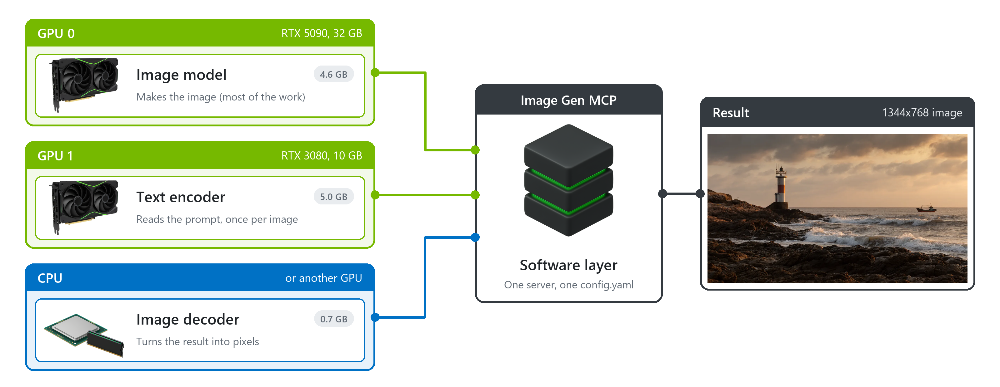

# Getting started

Each step of the first start, each choice, and what to do when something goes wrong. The examples show the
Windows scripts. On Linux, run the `.sh` scripts in a terminal (`./start.sh` instead of `start.cmd`). The
screens are almost the same.

## Before you start

| You need | Details |
|---|---|
| Docker | **Windows**: [Docker Desktop](https://docs.docker.com/desktop/setup/install/windows-install/) (WSL 2). **Linux**: [Docker Engine](https://docs.docker.com/engine/install/) with Compose, `curl`, and the [NVIDIA Container Toolkit](https://docs.nvidia.com/datacenter/cloud-native/container-toolkit/latest/install-guide.html) for a GPU. |
| GPU (optional) | NVIDIA RTX 20xx or newer, 8 GB or more (12 GB recommended), driver 570 or newer. Without a GPU, the server uses the CPU: several minutes per image. |
| Memory | Docker needs 16 GB or more. On Windows, Docker gets half of the RAM, so 32 GB of RAM is recommended. |
| Disk | 12-16 GB for the models, 6 GB for the server, and space for the first build. |

1. Install [Git](https://git-scm.com/downloads).
2. Open a terminal and run:

   ```bash
   git clone https://github.com/hypersniper05/MCP-Image-Generator-Uncensored.git
   ```

3. Open the new folder `MCP-Image-Generator-Uncensored`. The scripts are in this folder.

Without Git, download the ZIP file (**Code > Download ZIP** on GitHub) and extract it. A ZIP copy cannot update
itself.

## The four scripts

| Windows | Linux | What it does |
|---|---|---|
| `start.cmd` | `./start.sh` | Starts the server. If the first install did not finish, it runs the setup first. |
| `setup.cmd` | `./setup.sh` | Asks where the server runs and which model to use, then starts it. Your current settings are the defaults. |
| `update.cmd` | `./update.sh` | Installs the latest version. Settings, models and images stay. |
| `stop.cmd` | `./stop.sh` | Stops the server. |

Double-click a `.cmd` file. The window stays open at the end so that you can read the result.

**Answers**: the value in square brackets is the default. Press Enter to use it, or type a number. In a yes/no
question, the capital letter is the default: `[Y/n]` means Enter is yes, `[y/N]` means Enter is no.

## The first start

Double-click `start.cmd`. It does four steps.

### Step 1: Docker

```
Image Gen MCP
==> Checking Docker...
    Docker is running.
```

If Docker is missing or stopped, the script says what to do and stops. See [Messages](#messages).

### Step 2: Where the server runs

One GPU: the script shows it and continues.

```
    Memory Docker can use: 24 GB
    GPU: NVIDIA GeForce RTX 3080 Ti, 12 GB
```

Several GPUs: choose one.

```
    GPUs found:
      0) NVIDIA GeForce RTX 5090, 32 GB
      1) NVIDIA GeForce RTX 3080, 10 GB
      2) NVIDIA GeForce RTX 3080 Ti, 12 GB
      3) Custom load (multi-GPU and CPU)

Which GPU should the image server use?
Type a number and press Enter [0]:
```

- Choose a GPU that no other program uses. The whole model goes on it. If it does not all fit, the server keeps
  some weights in RAM by itself, at about the same speed.
- The last choice lets you place each part of the model yourself. See [Custom load](#custom-load).
- A GPU with less than 8 GB is too small. The script asks again. If it is your only GPU, the script offers the
  CPU.
- Without an NVIDIA GPU, the script asks `Continue on the CPU (several minutes per image)? [Y/n]`. If you have an
  NVIDIA GPU, type `n`, install its driver, and run `start.cmd` again.

If Docker can use less than 16 GB, the script warns you. See [Give Docker more memory](#give-docker-more-memory).

### Step 3: The model

```
    Choice          Download  Time per image  Needs
 1) Best quality     15.5 GB  ~90 s           GPU 12 GB+, 20 GB memory  <- recommended
 2) Standard         11.8 GB  ~90 s           GPU 12 GB+, 16 GB memory
 3) Turbo            11.4 GB  ~12 s           GPU 8 GB+ or CPU, 16 GB memory
```

| Choice | What you get |
|---|---|
| Best quality | Uncensored model, large text encoder. Best text and prompt following. |
| Standard | Uncensored model, small text encoder. Needs less memory. |
| Turbo | Official Turbo model, not uncensored. About 8 times faster. Weaker at small text. |

- **Download**: one time, on the first start with that model. **Time per image**: 1024x1024 on a 12 GB GPU.
- `<- recommended` is the best choice for your computer. `<- current` is the model that you use now.
- Best quality with less than 20 GB for Docker: the script asks `Use it anyway? [y/N]`. Type `y` to keep it.
- A model set by hand in `config.yaml` shows as `Keep the current model`. It is the default.

**Memory check**: if a GPU may not have enough memory for your choice, the script warns you:

```
    GPU 1 (NVIDIA GeForce RTX 3080, 10 GB) may run out of memory: its parts need about 10 GB.
    The server then works more slowly (it moves parts to RAM) or stops with an out-of-memory error.

  1) Confirm
  2) Choose another model
```

### Custom load

Only after `Custom load (multi-GPU and CPU)`. The model has three parts. You choose where each part runs.



| Part | What it does | Put it on |
|---|---|---|
| Image model | Makes the image. Most of the work. | The fastest GPU, or several GPUs. |
| Text encoder | Reads the prompt and the input images. | **RAM** (recommended for a GPU under 20 GB): the weights stay in RAM, it runs on the image model's GPU. Saves 5-9 GB of GPU memory. Or a GPU. On the CPU, edits take much longer. |
| Image decoder | Turns the result into pixels. The upscaler also runs here. | A GPU. On the CPU, each image and each upscale takes longer. |

The script asks for each part, then shows your choice:

```
Your custom load:
    Image model (4.6 GB):    GPU 0 (NVIDIA GeForce RTX 5090, 32 GB) + GPU 2 (NVIDIA GeForce RTX 3080 Ti, 12 GB)
    Text encoder (5.0 GB):   GPU 0 (NVIDIA GeForce RTX 5090, 32 GB)
    Image decoder (0.7 GB):  GPU 2 (NVIDIA GeForce RTX 3080 Ti, 12 GB)

  1) Confirm
  2) Start over
```

### The saved settings

```
==> Saved in config.yaml: Best quality (uncensored Q4_K_M, text encoder Q8_0)
    and the GPU settings: GPU 0 (limited to 10 GB); text encoder weights in RAM.
```

- **Limited to 10 GB**: on a GPU with less than 20 GB, the server plans for 2 GB less than the GPU has. The rest is
  for the screen and other programs.
- **Text encoder in RAM**: only when you chose it in the custom load.

The setup changes only the device, the GPU settings, the model and `generation.prefix_cache_type`. Your other
settings in `config.yaml` stay.

### Step 4: Build, download, start

```
==> Building the image server (first time only, 10-30 minutes)
==> Starting the server...
==> Downloading the model files (first time only, or after changing the model): 15.37 GB
    6.15 of 15.37 GB (40%)
==> Loading the model on GPU 0 (NVIDIA GeForce RTX 3080 Ti, 12 GB)...

Ready. Add this address to your AI app as an MCP server:
    http://localhost:5005/mcp
Status page: http://localhost:5005 (open it in a browser)
```

- If the build or the download stops, run `start.cmd` again. Both continue where they stopped.
- Add the address to your AI app (your MCP client). See [Connect an MCP client](../README.md#connect-an-mcp-client).
- The server runs in Docker, not in the window. You can close the window. Docker starts the server again after
  a restart of the computer, until you run `stop.cmd`.

## Later

| To | Run | What happens |
|---|---|---|
| Start the server | `start.cmd` | If it already runs, the script asks `Restart it? [y/N]`. It restarts without a question after an update that changed the server, or after an error. |
| Change the model or the GPU | `setup.cmd` | The same questions. Enter keeps each current setting. A new model downloads. The build is kept. |
| Update | `update.cmd` | Lists the updates and installs them. If the server changed, it asks `Do that now? [Y/n]` to build and restart. |
| Stop | `stop.cmd` | Stops the server. |

**Update with changed files**: if you changed a project file that the update also changes, the script asks:

```
  1) Cancel the update and keep the changes
  2) Discard the changes and install the update
```

With 2, git keeps a copy of your changes (`git stash list`) and of the old version (branch `before-update-...`).

**Old model files**: they stay in `models`. Delete them to free disk space. If you delete a file that the current
model uses, it downloads again.

## Messages

| Message | What to do |
|---|---|
| Docker is not installed. | Install Docker. Run the script again. |
| Docker is installed but not running. | **Windows**: start Docker Desktop and wait for "Engine running". **Linux**: `sudo systemctl start docker`. Run the script again. |
| Docker Desktop is running, but your Windows user may not use it yet. | Sign out of Windows and sign in again. |
| Docker is running, but your user may not use it. | **Linux**: `sudo usermod -aG docker $USER`. Log out and log in again. |
| Port 5005 is used by another program. | Close that program, or change `port` under `server:` in `config.yaml`. |
| Docker cannot reach the NVIDIA GPU. | **Windows**: update the NVIDIA driver (570+), restart the computer. **Linux**: install the NVIDIA Container Toolkit, restart Docker. |
| The build failed. | Check the internet and the free disk space. Out of memory: set `BUILD_JOBS=4` in `.env`. |
| The model does not fit in memory. | Run `setup.cmd` and choose a smaller model. |
| The model download failed. | Check the internet. Run `start.cmd` again. |
| The server stopped while starting. | The script shows the end of the server log with the cause. Correct `config.yaml` or run `setup.cmd`. |
| Images fail with "lost the connection to the inference engine". | The engine stopped, usually because it ran out of memory. Give Docker more memory, or choose a smaller model. |

Full log: open a terminal in the project folder and run `docker compose logs --tail 80`.

### Give Docker more memory

- **Windows**: open Notepad and type:

  ```
  [wsl2]
  memory=24GB
  ```

  Use about 8 GB less than your RAM (24GB for 32 GB of RAM). Select **File > Save as**, set **Save as type** to
  **All files**, and save as `%UserProfile%\.wslconfig`. If the file exists, add only the `memory=` line under
  `[wsl2]`. Then run `wsl --shutdown` and start Docker Desktop again.
- **Linux**: Docker can use all of the RAM. Close other programs.

## Where your files are

| File or folder | What it holds |
|---|---|
| `config.yaml` | Your settings. [`config.example.yaml`](../config.example.yaml) explains each one. |
| `.env` | Docker settings, for example the build options. The port comes from `config.yaml`. |
| `models` | The model files. |
| `outputs` | Your images and uploads. **The server deletes files older than 7 days.** To keep them, set `outputs.keep_days: 0` in `config.yaml`. |
| `inputs` | Images that the tools can read by file name. |

Updates do not change these files.
