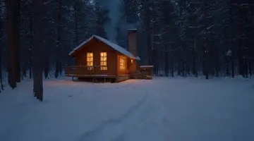
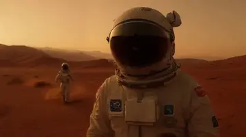
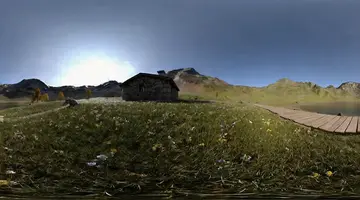
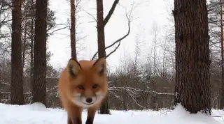
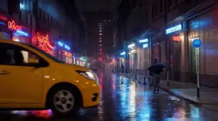
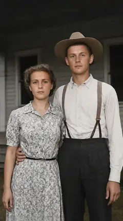

# Kandinsky 6 video extension

An optional extension that makes **5 to 20 second videos with sound** from a text description or from an image. It
also makes transparent animations for games and UIs, and GIFs. It uses
[Kandinsky 6 Lite](https://huggingface.co/kandinskylab/Kandinsky-6.0-Lite-distill-5s-Diffusers) in a 4-bit version
([OrbitQuant](https://huggingface.co/WaveCut/Kandinsky-6.0-Lite-distill-5s-OrbitQuant-W4A4)). It runs in its own
container in `extensions/kandinsky6/`, and its tools appear on the same MCP address as the image tools.

Kandinsky 6 Lite is a small model (3 billion parameters), chosen because it runs on consumer GPUs. It makes good
short clips, but its quality is not at the level of large video models such as
[MiniMax-H3](https://huggingface.co/MiniMaxAI/MiniMax-H3) (33 billion parameters), which need far more GPU memory.

**What it does well.** Calm motion that needs no physics: idle loops for game assets, steam, flames, blinking, small
gestures, water and clouds, and slow camera moves. Fast action and things that collide or interact (a ball game, a
dog chasing a stick, a vehicle crash) often go wrong: a large model handles those better. An extension for
MiniMax-H3 is in the works.

* [Samples](#samples)
* [Tools](#tools)
* [How to prompt](#how-to-prompt)
* [Transparent videos](#transparent-videos)
* [Install and uninstall](#install-and-uninstall)
* [Speed and memory](#speed-and-memory)
* [Safety and licenses](#safety-and-licenses)

## Samples

Click a preview for the full video with sound. The previews are smaller and have no sound. The prompts are in the
[table below](#prompts-of-the-samples).

<table>
<tr>
<td> Image to video: the <a href="../README.md#make-your-own-text-to-image">lighthouse photo</a></td>
<td> Text to video</td>
</tr>
<tr>
<td> Text to video</td>
<td> Image to video: the <a href="../README.md#make-your-own-360-panorama">360 panorama</a></td>
</tr>
<tr>
<td> 15 seconds: three 5-second parts, each with its own prompt</td>
<td> An explicit prompt: the taxi's direction and a static camera (see <a href="#how-to-prompt">How to prompt</a>)</td>
</tr>
</table>

<table>
<tr>
<td> Image to video: the <a href="../README.md#make-your-own-restoration">restored photo</a></td>
<td> Transparent: the <a href="../README.md#make-your-own-transparent-png">transparent PNG</a></td>
<td> Transparent: a game UI asset   Transparent: a game character</td>
</tr>
</table>

More transparent animations are in the README's [Animation](../README.md#make-your-own-animation) gallery.

## Tools

- `generate_video`: text to video, or image to video (the image is the first frame). `seconds`: 5, 10, 15 or 20.
  A longer video is made of 5-second parts. Each part starts on the last frame of the part before it, and
  `next_prompts` say what happens in each part. Also:
  - `aspect_ratio`: 16:9 (864x480), 9:16 (480x864) or 1:1 (640x640). With an image, it follows the image's shape.
  - `quality`: `standard` (480p) or `draft` (320p, about 2.5x faster).
  - `sound`, `seed`, `gif` (also save a GIF) and `transparent` (see [Transparent videos](#transparent-videos)).
  - `count`: up to 4 variations, each with the next seed. Each one waits for its own turn on the GPU, so on a
    shared GPU images can run between them.
- `extend_video`: add 5 to 15 seconds to a video, starting on its last frame.
- `video_to_gif`: turn a video into an animated GIF (`width`, `fps`, and `start` and `seconds` for a part of it).
  It runs on the CPU in about a second and does not wait for the GPU. A transparent WebM gives a transparent GIF.
- Videos are MP4 files (H.264 and AAC, 24 fps) in `./outputs`, and the [web gallery](../README.md#the-web-gallery)
  plays them.
- The model can only use a start frame. There is no support for an end frame.

## How to prompt

The model does what the prompt says and does not work out the rest. There are no trigger words. Write one
paragraph in this order:

1. The shot and the main subject: "Wide shot of a narrow city street at night in heavy rain."
2. One camera sentence: "The camera is static." or "The camera pans slowly to the right."
3. What moves, which way and how fast: "A yellow taxi drives slowly from the left edge to the right edge."
4. What stays still. For a person who does not speak, write "her lips stay closed".
5. The sound last, after `Audio:`. The extension puts it in the model's own sound tag (`<AUDCAP>`). Put spoken
   words in `<S>` and `<E>`: `She says: <S>Hello there.<E>`

With an image, describe only what happens next: the image is the first frame.

**Token limits.** The prompt encoder (Qwen2.5-VL) reads the first 1,024 tokens of the prompt (about 750 words).
A second encoder (CLIP) reads only the first 77 tokens, so put the main subject first. The model's own prompt
writer makes prompts of 180 to 300 words. The tool list of the image server and this extension adds about 7,500
tokens to the MCP client's context.

## Transparent videos

`transparent: true` makes a video with a transparent background: game assets, UI animations and stickers.

1. Make or upload an image with a transparent background (`generate_image` with `transparent: true`).
2. Call `generate_video` with that image and `transparent: true`. Describe motion in place: the subject stays
   inside the frame and the camera does not move.

The extension puts the image on a flat key color (green, or blue when the subject has green in it), and adds a
static camera to the prompt. It then removes the key color from every frame and keeps soft edges and see-through
parts such as steam and hair. The image is fitted to the video's shape, not cropped. The results:

- A WebM (VP9 with transparency, with sound). It plays transparent in Chrome, Edge and Firefox, not in Safari.
  An MP4 cannot be transparent.
- A small animated WebP (480 px, 12 fps) with soft transparent edges. It works anywhere an image works.
- With `gif: true`, a GIF. GIFs have no soft edges: each pixel is shown or not.

`extend_video` does not support transparent videos yet.

## Install and uninstall

**Install.** Run `setup.cmd` (Windows) or `./setup.sh` (Linux) and answer yes to the Kandinsky 6 question. The
setup chooses the GPU and the memory mode, builds the container and downloads about 13 GB once.

**Uninstall.** Run the setup again and answer no. The setup stops and removes the container and its Docker image,
and takes the extension out of `config.yaml`. Then it asks whether to delete the downloaded files (about 13 GB).

## Speed and memory

Measured with one 864x480 clip of 5 seconds with sound. The first clip after a start takes up to 30 s longer (the
GPU kernels are compiled once).

| Setup | Mode (set by the setup) | 5-second clip | GPU memory | RAM (video) |
|---|---|---|---|---|
| RTX 5090 32 GB, video only | `resident` | 42-59 s | 17 GB | 7 GB |
| RTX 5090 32 GB, shared with the image model | `fast`, both run at once | 49 s (photos meanwhile: 5-9 s) | 24 GB for both | 15 GB |
| RTX 3080 Ti 12 GB, video only | `low-memory` | 115-122 s | 10 GB | 15 GB |
| RTX 3080 Ti 12 GB, shared with the image model | `stream`, one job at a time | 139-147 s (photos: 11.4 s) | 5.5 GB + 6 GB for images | 15.5 GB |
| RTX 3080 10 GB, video only | `low-memory` | 161-174 s | 8.6 GB | 16 GB |
| Two GPUs: images on an RTX 3080 Ti, video on an RTX 3080 | `low-memory` | 161-171 s (photos meanwhile: 10.9 s) | separate cards | 14 GB |
| 15-second video (3 parts), RTX 5090 | `resident` | 126-146 s | 17 GB | 7 GB |

**RAM.** The RAM column is the video container's peak. With images and video together, add the image server: about
6 GB, and up to 15 GB for the largest jobs (2048-pixel transparent images, 8192-pixel upscales).

| Installed | Docker memory needed |
|---|---|
| Images only | 12-16 GB |
| Images + video in `resident` mode (24 GB+ GPU) | about 13-22 GB |
| Images + video in the other modes | about 21-31 GB |

An 8 GB GPU uses the `stream` mode (about 5.5 GB); this was not measured on a real 8 GB card. The video needs an
NVIDIA GPU: it does not run on a Mac, and on the CPU a 1-second, 320p test clip took more than 50 minutes
(i9-14900K).

**Images and videos on one GPU.** `extensions.max_jobs` in `config.yaml` sets how many GPU jobs run at once.
With `auto`, a GPU of 12 GB or less that has both runs one job at a time: a video waits for an image and an image
waits for a video. A larger GPU, or two GPUs, run both at once.

## Safety and licenses

The video container has no internet access and no port on your computer: only the image server can reach it. It
runs as a normal user with a read-only system. The model files are checked against their SHA-256 sums, and only
`.safetensors` weight files are loaded.

The model has parts with their own licenses. The audio decoder allows non-commercial use only, and the video VAE's
license does not cover the EU, the UK or South Korea. See [Origins & License](../README.md#origins--license) before
you install the extension there or use its videos commercially.

## Prompts of the samples

| Sample | Settings | Prompt |
|---|---|---|
| Lighthouse | `generate_video` with the lighthouse photo, 16:9, seed 1036140235 | Waves crash against the dark rocks below the red and white lighthouse at golden hour. White spray bursts up and drains back between the rocks, the small fishing boat rocks gently, and the clouds drift slowly. The camera holds steady with a slow push in. Audio: crashing waves, hissing foam, wind and distant seagulls. No dialogue, no music, no text, no logos. |
| Cabin | `generate_video`, 16:9, seed 202 | Wide shot of a small wooden cabin in a snowy pine forest at night, its windows glowing warm orange. The camera pushes in slowly toward the cabin. Snow falls gently from the sky, and gray smoke rises from the stone chimney and drifts to the right. The pine trees and the cabin stay still. Moonlight, cozy, realistic. Audio: soft wind, quietly a crackling fire. No dialogue, no music. |
| Astronaut | `generate_video`, 16:9, seed 101 | Wide shot of an astronaut in a white spacesuit walking slowly across red sand dunes on Mars, toward the camera. The camera is static. Each step kicks up small clouds of red dust that drift to the left. A pale sun is low in the dusty orange sky behind the astronaut. Realistic, cinematic. Audio: loudly, slow breathing inside the helmet; crunching footsteps; a thin wind. No dialogue, no music. |
| Meadow | `generate_video` with the 360 panorama, 16:9, seed 202 | A mountain meadow with wildflowers, a stone cabin, a wooden boardwalk and a lake. The camera pans slowly to the right across the meadow. The wildflowers and the grass sway in a light breeze, small clouds drift slowly over the mountains, and the lake ripples. Bright summer daylight, realistic. Audio: a light breeze, bees, birdsong. No dialogue, no music. |
| Old photo | `generate_video` with the restored photo, 9:16, seed 1398660936 | The young couple on the porch smiles and turns to look at each other, the woman laughs softly and the man tips his hat. A light breeze moves her dress and the trees behind them. Natural, gentle movement, the camera holds steady. Audio: birds, a light breeze, distant farm sounds. No dialogue, no music, no text, no logos. |
| Fox, 15 s | `generate_video`, `seconds: 15`, 16:9, seed 61000 | Part 1: A red fox walks through a snowy pine forest toward the camera. The camera follows at ground level. Natural daylight, realistic fur. Audio: soft footsteps in snow and wind in the trees. No dialogue. Part 2 (`next_prompts`): The same red fox stops in the snowy pine forest, lowers its head and listens to the snow, ears turning, then starts to dig with its front paws. Same light, same forest, camera at ground level. Audio: wind in the trees, paws scratching snow. No dialogue. Part 3: The same red fox jumps high and dives nose-first into the deep snow of the pine forest, then pops back out with snow on its face and shakes it off. Same light, same forest, camera at ground level. Audio: a soft thump into snow, snow falling off fur, wind. No dialogue. |
| Rain street | `generate_video`, 16:9, seed 21 | Wide street-level shot of a narrow city street at night in heavy rain. The camera is static. Red and blue neon signs glow on both sides of the street and reflect on the wet pavement. A yellow taxi enters from the left edge of the frame, drives slowly to the right through the puddles with water splashing from its wheels, and leaves the frame at the right edge. On the sidewalks, a few people with black umbrellas walk away from the camera. The rain falls steadily. Realistic, cinematic. Audio: loudly, steady rain on the pavement; a car passes from left to right with splashing tires; distant traffic. No dialogue, no music. |
| Dragon | `generate_video` with a transparent dragon image, `transparent: true`, `sound: false`, 1:1, seed 202 | See the README's [prompts table](../README.md#prompts-and-settings). |
| Cauldron | `generate_video` with a transparent cauldron icon, `transparent: true`, `sound: false`, 1:1, seed 1835987638 | Camera completely static and locked off, wide shot matching the first frame exactly: the whole black iron cauldron bowl is visible and centered, including its round body, its rolled rim, the ring handle on the right and its three short claw feet at the bottom. Do not zoom, do not crop, do not pan, no camera movement at all. Only the liquid and steam move: round green bubbles slowly swell up to the surface and pop with tiny splashes, thin translucent green steam wisps curl upward and fade near the top, a few small droplets arc up and fall back, and the green glow pulses gently. Everything else stays exactly as in the first frame. |
| Woman | `generate_video` with the transparent PNG, `transparent: true`, `sound: false`, 9:16, seed 77 | Medium close-up, waist-up portrait of the young woman with long curly red hair. The camera is static. She looks straight into the camera with a calm, gentle smile; she does not speak and her lips stay closed. She blinks slowly two times, about two seconds apart. Her head and shoulders stay still and she stays centered in the frame; a light breeze moves a few strands of her hair. |
