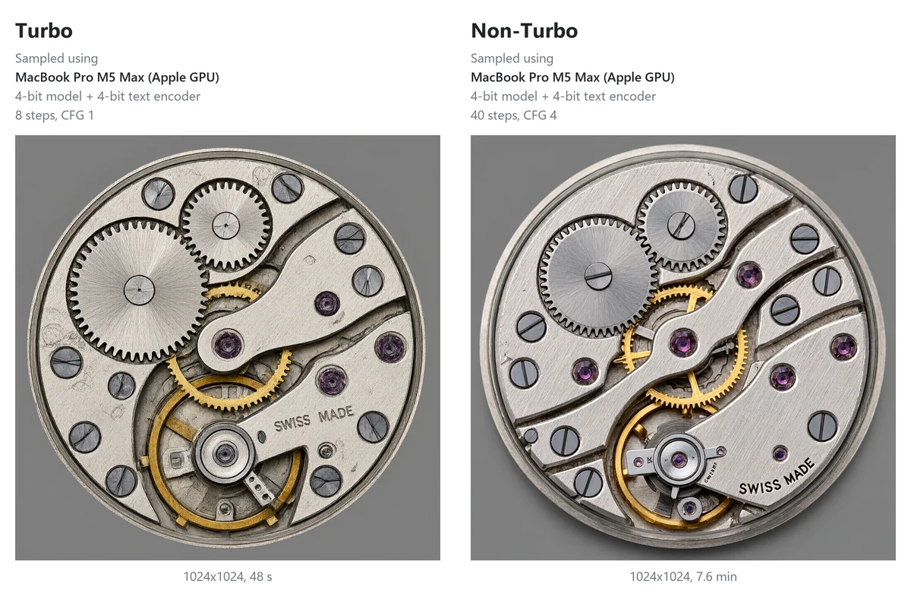
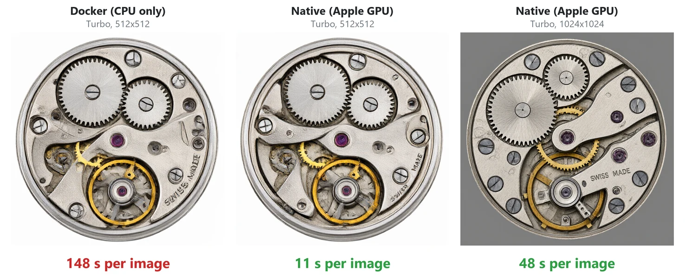

# Mac

Today the server runs on a Mac in Docker, and Docker on a Mac uses only the CPU. A native version that uses the
Apple GPU is in development. In tests it was about 13 times faster. See [Status](#status).

MacBook Pro M5 Max, 128 GB. "Native" is the version in development, on the Apple GPU. Turbo uses 8 steps and CFG 1.
Non-Turbo uses 40 steps and CFG 4. Both use the 4-bit model files.

| Job | Turbo | Non-Turbo |
|---|---|---|
| Native, 1024x1024 | 48 s | 7.6 min (4-bit text encoder), 7.0 min (8-bit text encoder) |
| Native, 512x512 | 11 s | - |
| Native, edit at 1024x1024 | 69 s | 9.8 min |
| Docker (CPU only), 512x512 | 148 s | - |
| Memory, native | about 10 GB (an edit about 13 GB) | about 18 GB with edits |

- **Use Turbo on a Mac.** The Non-Turbo model takes 7-10 minutes per image.
- **Use 1024x1024 or larger for text.** At 512x512 the text is not readable (see "SWISS MADE" in the second image).
- A Mac with 16 GB of memory may run Turbo natively: new images used about 10 GB, an edit about 13 GB. This is not
  tested yet.
- The Non-Turbo model with edits uses about 18 GB. Use a Mac with 24 GB or more.

## Status

The native Mac version is in development. The scripts do not install it yet.

Until it is ready, Docker works on a Mac, but only on the CPU:

1. In Docker Desktop, open **Settings > Resources** and set **Memory** to 16 GB or more. With the default
   (about 8 GB), the first image fails.
2. Double-click `start.command`, and choose Turbo.

A faster engine for the Apple GPU (Apple MLX) may follow. A published result shows it about 3.5 times faster per
step than the current native engine. It is not tested here yet.
